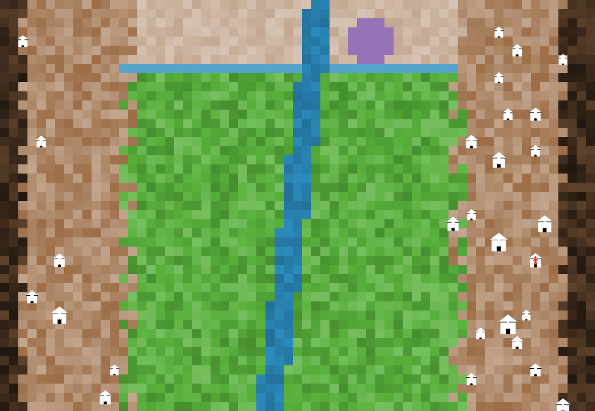
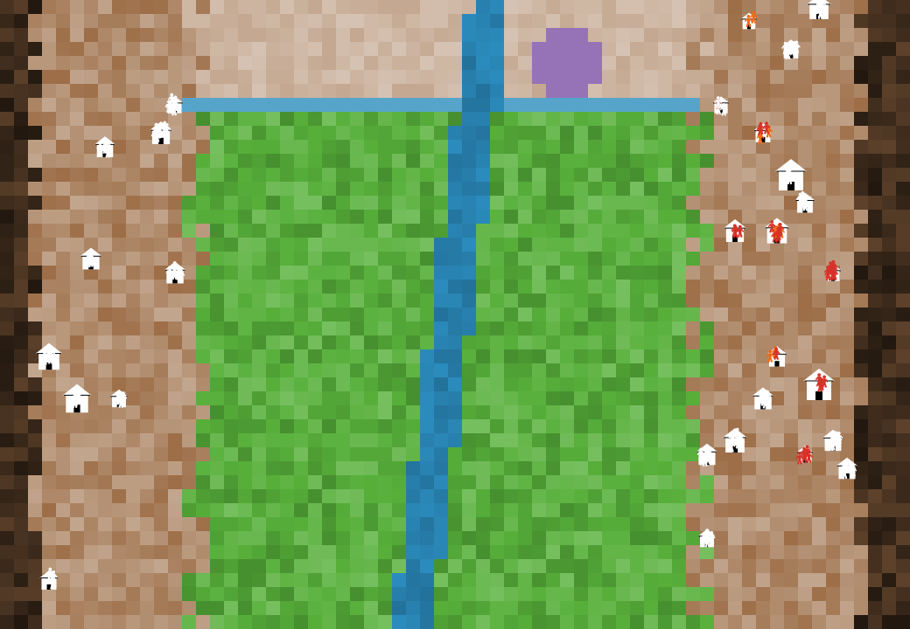
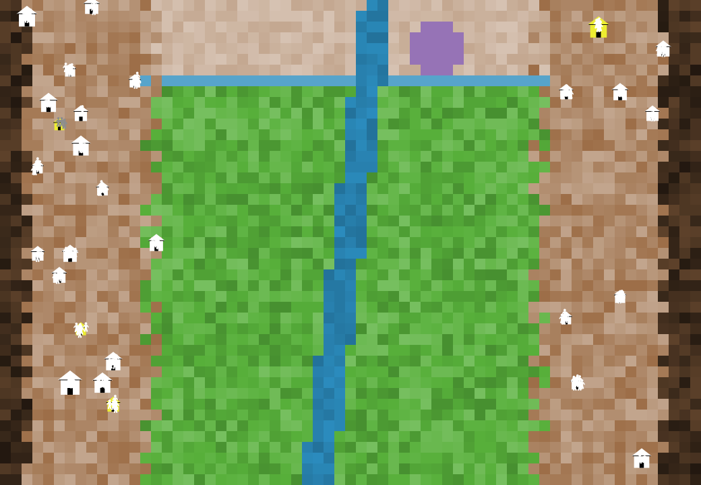

# Plague in Tadrar: A Plague Inc-Style Epidemic in a Berber Village

> **Note:** This is an academic project for ANTH 404 (Agent-Based Modeling) at UNC-Chapel Hill — a teaching model, not validated epidemiological or anthropological software.

## Overview

This repository is a **NetLogo** agent-based model that drops a **Plague Inc**-style designer pathogen into a real Berber village. The village is **Tadrar**, in Morocco's High Atlas, as documented in David Crawford's *Moroccan Households in the World Economy* (2008). The model asks one question: how does a pathogen's design interact with Tadrar's communal labor (**khams**) to shape an epidemic & what does the shock do to households?

One tick is one day & a run lasts a year. The project ships with the model & a 14-slide companion deck that walks through the design, the experiments, & the results.

## Technical Specifications

- **Platform**: NetLogo 7.0.4
- **Type**: Agent-based model (ABM)
- **World**: a drawn 65 × 45 patch valley — mountains, dry slopes, river-fed fields, an irrigation canal, & the khams site
- **Agents**: two breeds — **households** (28, per Crawford) & **villagers** (~170 people)
- **Disease dials**: infectivity, lethality, stealth, sick-days, & mutation (Plague Inc-style)
- **Experiments**: 4 embedded BehaviorSpace parameter sweeps
- **Companion deck**: 14-slide PowerPoint walkthrough

## Core Features

**The disease (Plague Inc-style).** A single pathogen with sliders for how catchy, how deadly, & how sneaky it is, plus a slow-filling cure bar & a mutation day that can flip a mild strain deadly. Three one-click presets demonstrate the **virulence-transmission trade-off**: a **Burnout plague** (deadly & obvious), a **Silent spreader** (mild & sneaky), & a **Plague Inc strategy** (silent, then mutates on day 20).

**The village (Crawford's Tadrar).** 28 households on unequal **land**, each farming a field, storing **grain**, & owing labor to **khams** — the communal work that keeps the irrigation canal clear. Khams repairs the canal, a healthy canal raises the harvest, grain feeds the household, & a hungry house is likelier to lose its sick. Some workers **migrate** for wage labor. Deaths past a threshold trip an **alarm**, scared households withdraw from khams, & the commons starts to break down.

**The analysis.** Outcomes come from multi-run BehaviorSpace experiments (20 reps for the presets & the khams sweep, 10 for the lethality sweep), reporting mean values, standard deviations, & fizzle counts. Household inequality is tracked with both the raw grain gap (standard deviation) & the scale-free coefficient of variation.

| Preset | Infectivity | Stealth | Sick days | Lethality | Mutation |
| --- | --- | --- | --- | --- | --- |
| Burnout plague | 20% | 3 | 5 | 80% | — |
| Silent spreader | 15% | 8 | 7 | 5% | — |
| Plague Inc strategy | 15% | 8 | 7 | 5% → 70% | day 20 |

## Project Structure

```
Plague in Tadrar v2/
├── Plague in Tadrar v2.nlogox              # the model — open this in NetLogo 7.0.4
├── ABM Final Project Presentation v2.pptx  # 14-slide companion deck
├── images/                                 # screenshots used in this README
└── README.md
```

## Running the Project

**Prerequisites**

- NetLogo 7.0.4

**Run the model**

1. Open `Plague in Tadrar v2.nlogox` in NetLogo.
2. Press a preset button — **Burnout plague**, **Silent spreader**, or **Plague Inc strategy**. Each builds its own scenario in a single click (there is no separate setup button by design).
3. Press `**go**`. The village sliders (`num-households`, `khams-interval`, `withdrawal`, `migration`, `initial-infected`) can be set beforehand; the disease dials are set by the presets.

**Run the experiments**
Open **Tools → BehaviorSpace** & run any of `lethality-sweep`, `lethality-sweep-emergence`, `withdrawal-sweep`, or `khams-interval-sweep`.

## Key Findings

- **Khams is the main route the disease travels.** Holding the silent strain fixed & changing only how often the village gathers: khams every 7 days infects ~18% of the valley, every 3 days ~71%, every day ~94%. The communal labor that keeps the canal alive is also the disease's highway between households.
- **Lethality is a threshold, not a smooth slope.** A strain reaches ~42% of the valley at low lethality; once it is deadly enough to kill ~3 people it trips the alarm, & past that the outbreak drops to a noisy ~15-30% & stops growing. The cap comes from the village's khams-withdrawal reacting sooner, not from host biology.
- **The plague doesn't level the village — it just makes everyone poorer.** The raw grain gap ends *lower* with the plague (~403 → 285), which looks like leveling, but only because the whole harvest shrinks (average grain ~293 → 199). Measured relative to the average (coefficient of variation), inequality does *not* fall — it holds about flat, if anything edging up (~1.37 → 1.43). Inequality here is set by unequal **land**, not by the plague.

## Screenshots

**The valley at day 0** — 28 households on the slopes, fields along the river, the canal across the top, & the khams site in purple. Houses are sized by their land, so inequality shows at a glance.



**The three strains, mid-outbreak**

| Burnout plague (day 9) | Silent spreader (day 30) | Plague Inc strategy (day 30) |
| --- | --- | --- |
|  |  |  |
| Tears through a few houses, then burns out. | Rides khams across the valley, kills few. | Spreads quietly, then mutates deadly. |

## Sources

- Crawford, D. (2008). *Moroccan Households in the World Economy: Labor and Inequality in a Berber Village.* LSU Press.
- Anderson, R. M., & May, R. M. (1982). Coevolution of hosts and parasites. *Parasitology, 85*(2), 411-426.
- Lansing, J. S., & Kremer, J. N. (1993). Emergent properties of Balinese water temple networks. *American Anthropologist, 95*(1), 97-114.
- West, C. T. (2009). Domestic transitions, desiccation, agricultural intensification, and livelihood diversification among rural households on the Central Plateau, Burkina Faso. *American Anthropologist, 111*(3), 275-288.
- Ndemic Creations. (2012). *Plague Inc.* [Video game].
- Wilensky, U. (Spread of Disease, Flocking, & NetLogo); Wilensky, U., & Rand, W. (2015). *An Introduction to Agent-Based Modeling.* MIT Press.

## Team Credits

Made with ❤ by **Chigozie Nnani**, created for ANTH 404 at UNC-Chapel Hill.

## License & Ethics

An educational & portfolio project only. The epidemic is a game-inspired teaching model, not a validated disease simulation, & the village is a deliberately simplified abstraction of Crawford's ethnography, not a dataset about real people. Not for commercial use.
